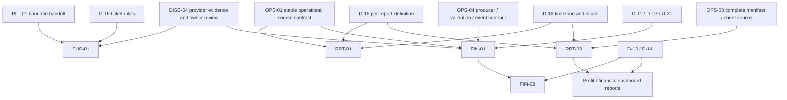

# DISC-04: Dev 3 discovery and readiness

## Accepted discovery closure — DONE WITH NOTES (2026-11-15 Asia/Bangkok)

The project owner explicitly instructed: “temuan dari legacy website kita ambil seadanya saja” and requested DISC-04 “DONE atau DONE with NOTES” so other Dev3 work is not blocked by DISC04. This is acceptance of the discovery deliverable **as available**, including documented unknowns. It supersedes earlier PARTIAL/financial-formula completeness assessments as a ticket-closure criterion; it does not change the recorded observations or approve unverified business behavior. Earlier chronological sections below are historical where status differs.

- DISC-04: **DONE WITH NOTES**; discovery dependency is satisfied for SUP-01/FIN-01 and downstream planning. No requirement to find a populated finance period, repeat provider navigation or resolve every D-ID to close DISC04.
- Accepted deliverables: LD001–046 qualified evidence,22-report catalogue, ticketing/accounting/dashboard structures, source mappings, parity/regression proposals, decision packet and dependency handoff. No new provider evidence is fabricated by closure.
- Carried notes: unverified financial formulas/reconciliation; report/export outputs not safely observed; ticket lifecycle/assignment/reopening/history; role/branch cases; date/TZ/source semantics; ledger/category/P&L not reached. Keep these as feature-specific open questions, never generic DISC04 blockers.
- D11–16/D19/D21 remain formalTBD,D24PARTIAL. User discovery acceptance is not confirmation of these rules, approval of FR07 amendments, finance implementation or protected-autonomous access. Runtime gates apply only to behavior that actually depends on each unresolved rule.
- Next active work: SUP-01 contract preparation/review, using observed legacy structure. Concrete draft in docs/decisions/SUP-01-contract.md. Runtime CRUD/lifecycle is not yet READY until its specific D16/model/authorization approvals; DISC04 must not be listed among its remaining blockers. RPT01 likewise retains only applicable D15/D19/source/grant gates. FIN remains deferred on actual financial/source decisions, not discovery completion.

Historical pre-acceptance continuation: **PARTIAL**, direct authenticated provider UI observation under explicitly user-authorized DIRECT_NON_MUTATING_DISCOVERY. Current LD evidence section/catalogue supersedes historical no-live/protected-infrastructure blockers for this procedural mode. Business approvals remain separate; full acceptance not yet met.

Baseline: c40650299674faca3f4d5e6cb92a8675ac6c1ffc, verified remote main 2026-11-14. Branch: docs/disc-04-dev3-readiness. Initial discovery baseline was documentation-only. Current continuation performs authorized direct provider observation; no product feature, migration, seed, financial/shared domain contract or merge/deploy. Earlier infrastructure-only stages below are historical. See execution-preparation continuation below. Repository/offline discovery deliverable complete for available evidence; formal DISC-04 full-behavior/owner-acceptance criteria remain PARTIAL. Independent QA completed; sole P2 corrected and bounded recheck confirmed resolved.

## Evidence and method

Current evidence vocabulary: LEGACY_VERIFIED = directly established legacy behavior with exact safe provenance and enough evidence for the stated claim (not automatic business approval); REPO_VERIFIED = inspected repository/configuration fact; INFERRED = interpretation not directly established; UNVERIFIED = absent/incomplete direct evidence. Historical PROVIDER_OBSERVED menu notes remain inherited label evidence and are not promoted to LEGACY_VERIFIED. TBD describes decision status; BLOCKED describes a work/control gate, not evidence that legacy behavior does not exist.

Read AGENTS.md, docs/PRD.md, docs/ROADMAP.md, docs/decisions/DEV2-DEV3-HANDOFF.md, OPS-04-contract.md and four docs/agent-policies policies. Read initial STATE/HANDOFF templates and reconciled actual Git. Superpowers using-superpowers selected workflow, dispatching-parallel-agents separated independent requirements/source/offline exploration, writing-plans structured the discovery/dependency plan in this allowed document, systematic-debugging traced stale claims to source/API evidence without fixes. requesting-code-review and verification-before-completion support final review/checks. No implementation/TDD workflow invoked. Plan location follows user's six-file write restriction; no redundant implementation plan created.

Discovery plan: verify baseline/policies -> save initial checkpoint -> independent inventories -> local comparison -> dependency/decision synthesis -> independent QA -> file/scope verification and local documentation commit. Lead owns all six documents; specialists write none. Requirements/source role presets GPT-6.1 Sol Medium; safety/reviewer presets fixed Sol High. Parent runtime/model cannot be changed by the agent; no claim that a model switch occurred.

## Baseline, PR #9 and stale snapshots

- REPO_VERIFIED: local main HEAD, GitHub main API and git ls-remote origin refs/heads/main agreed at c40650299674faca3f4d5e6cb92a8675ac6c1ffc. Remote code-craft-id/logistik-web. PR #9 merged at 2026-11-13T12:36:55Z, squash/merge SHA same baseline; final head 561a382746e96eab46e47d9dc4dc1b3be7863688. Sources: https://github.com/code-craft-id/logistik-web/pull/9 and GitHub REST pulls/9, branches/main.
- REPO_VERIFIED: reviews endpoint records APPROVED on final PR head at 2026-11-13T11:52:00Z. Earlier changes-requested/commented/dismissed reviews are history. docs/decisions/DEV2-DEV3-HANDOFF.md:7 OPEN/CHANGES_REQUESTED is stale. Approval accepts PR scope; it does not confirm D-11..D-16/D-19/D-21 or prove missing staging artifacts.
- Worktree dirty before this run: .gitignore, AGENTS.md; untracked docs/agent-policies/, docs/agent-prompts/, docs/agent-state/. No existing work reset/staged by this run outside six checkpoint files. Created requested docs branch at identical baseline; no source version changed, no server restart.
- PR body reports 44 files/423 tests and 11 integration files/98 tests at earlier PR commits; these are AUTHOR-REPORTED, not fresh baseline verification. docs/decisions/evidence/pr-9-staging-smoke.md:5-20 still contains user-reported PASS with missing tester/time/environment/deployed SHA/per-scenario artifacts. Merge/approval and incomplete staged-evidence documentation can both be true.
- OPS-04-contract.md:13 names nonexistent src/features/bookings/billing-events.ts. Actual declaration src/features/bookings/billing-contract.ts:1. Proposal status is correctly PROPOSED, not emitted/enforced.
- Historical FND-03 inventory (FND-03-iteration-2.md:115) and SCH-01 historical Customer absence (SCH-01.md:135) are not current model evidence. Current sales schema has operations/Customer/Consignee references. Dashboard preview description also predates operational booking/transaction routes; all quick actions still describe UI previews (dashboard-overview.tsx:26,133-136).
- ROADMAP.md:111 archival advice conflicts with specific confirmed D-29 non-archival rule (PRD.md:175,243). Follow D-29; no private images/records copied.

## Runtime versus previews and source contracts

| Finding | Category / evidence | Readiness consequence |
| --- | --- | --- |
| Booking create, transaction create/lookup/detail/status services/actions exist; operational UI routes present | REPO_VERIFIED; src/features/bookings/{actions.ts,lookup-actions.ts,server/service.ts,server/queries.ts}, src/app/(dashboard)/{bookings,transactions}/; handoff:17-19,43-50 | Existence does not approve D-05..D-07/D-21, staging or report semantics. Local browser flow not verified. |
| Manifest mutations exist but /manifest is preview | REPO_VERIFIED; src/features/shipments/manifests-actions.ts; server/manifests-service.ts; src/app/(dashboard)/manifest/page.tsx:1 | OPS-03 remains partial, not end-to-end delivery. |
| Outcome requires an existing sheet; generator absent in source search | REPO_VERIFIED; manifests-service.ts:257-260; item creation at :320 is not sheet generation; sales.prisma:256 unique manifestId | Dev 2 generation/eligibility/numbering/retry contract needed. Do not assume delivery report source population complete. |
| Assignment globally unique per transaction; released reassignment denied | REPO_VERIFIED; prisma/schema/sales.prisma:248; authorization-booking-transaction-manifest-delivery.test.ts:570 | D-08 remains TBD; do not design re-manifest reports around invented multiple assignment behavior. |
| OPS-04 type unused by runtime producer/validator/consumer in inspected src/tests | REPO_VERIFIED; billing-contract.ts:1; OPS-04-contract.md:3,9-14,46-65 | FIN-01 blocked by missing event lifecycle, transport normalization, dedupe and vendor/service mapping, as well as D-11. |
| All report routes use synthetic PreviewScreenPage metadata; export disabled | REPO_VERIFIED; branch-reports/transaction-details/page.tsx:1; reports/preview/screens.ts:3; components/patterns/preview-screen.tsx:20; preview-workspace.tsx:286,332,603,682 | No operational report query, approved financial total or functioning export established. See REPORT_CATALOGUE.md. |
| /ticketting preview only; no Ticket Prisma model/service/query/action found | REPO_VERIFIED; ticketting/page.tsx:1; features/ticketing/preview/screens.ts:5-162 | SUP-01 blocked D-16. Exact route spelling ticketting differs from feature ticketing and target structure; do not rename without contract review. |
| Dashboard authenticates but metrics unavailable, charts synthetic and filters local | REPO_VERIFIED; dashboard/page.tsx:10; dashboard-overview.tsx:88-109; dashboard-filters.tsx:12,83; dashboard-chart.tsx:31 | No KPI pipeline/approved metrics; labels are not definitions. |
| Financial drafts unused by inspected runtime; guard is policy/current nonuse | REPO_VERIFIED; prisma/schema/accounting.prisma DRAFT comments; db/index.ts:10 ordinary client; sch01-schema.test.ts:83 regex-checks comments | No technical draft-denial guarantee. AccountingBranch differs from organization Branch (:52). No operational Invoice/Payment model found. No finance readiness. |

Naming: provider Manifest Vendor vs preview Penjual Manifes, financial/customer/courier workspace names and report recaps cannot be assumed semantic equivalents. Catalogue lists unmapped standalone Rekap Transaksi, Rekap Manifest, Rekap Transaksi Harian. Existing branch-reports/daily-turnover-summary is not proof it satisfies either transaction recap.

## Authorization and tests

REPO_VERIFIED: identity/permissions.ts:2 registers operational booking/transaction/manifest/delivery grants, no report/dashboard/ticket/accounting workflow grants. Active actor/group and system_admin:manage define admin authority, not a role label. New unknown resource/action denies even admin until inventory reviewed. lib/auth/session.ts:34 says empty branches do not mean HQ/global.

bookings/server/queries.ts:23,47,87,114 filters deleted rows and scopes branch records; transaction scope is origin OR destination at :104. Internal query helpers rely on page/action callers for action permission checks (transactions/page.tsx:10, [id]/page.tsx:20); this is an existing call-site contract, not report authorization. Future reports need independently authenticated/authorized entry points, reviewed grants and validated branch/date/status/pagination/export contracts. Default take=50 is not an approved or fully validated report paging API. accessible-navigation.ts:19 inventory lacks several operational and Dev3 route mappings; menu visibility is not route readiness/authorization. The workspace layout alone does not authorize arbitrary children; proxy.ts supplies session boundary, which is distinct from per-entry data authorization.

Coverage inspected, NOT executed:

- tests/features/bookings/idempotency.test.ts:161 replay, :219 conflict, :268/:293 manufactured P2002 recovery; Prisma mocked, not overlapping PostgreSQL transactions.
- tests/unit/authorization-booking-transaction-manifest-delivery.test.ts:66 mocked DB covers service denial/scope/soft-delete cases; not real concurrency proof.
- tests/unit/manifests-security.test.ts:41,45 membership/unique-constraint titles only assert branch membership; cannot establish sheet membership or DB uniqueness enforcement.
- tests/integration/sch01.test.ts:130 uniqueness covers customer tax profiles, not operational idempotency/races.
- tests/unit/dashboard-ssr.test.ts:7 and preview UI tests concern synthetic presentation, not metric reconciliation.

Dev 2-owned follow-up: guarded logistik_web_test concurrency regression for simultaneous same-key creates, manifest assignment, outcome/status atomicity. This is a proposed cross-domain task, not authorized implementation or an unmerged blocker retroactively imposed on PR #9. No test DB accessed.

## Local server verification and limitations

REPO_VERIFIED listener on port 3000, PID 9828, command points to this checkout's next start-server.js. Existing server reused and preserved. HTTP/UI UNVERIFIED: local-only isolated Chrome new_page report request timed out at 10s; curl HEAD localhost/login timed out at 20s; direct no-proxy 127.0.0.1/login timed out at 15s, zero bytes, curl 28 both. Subsequent shell commands succeeded, so batch exit 0 must not be called HTTP success. No authenticated UI/responsive/manual staging check completed.

Listener executable Node v26.13.0 differs from package.json engines >=24.15.0 <25. Cause of timeout UNVERIFIED; no repair/restart authorized by documentation-only scope. Chrome page metadata listed an existing legacy tab after failed local-tab creation; no DOM/snapshot/auth/network inspection or navigation performed against it. Metadata presence establishes neither legacy authentication nor a safety boundary.

## Provider and decision evidence

Inherited PROVIDER_OBSERVED report-menu notes contain 22 leaves; source/provenance and 19 primary plus four rendered AR/AP supplemental synthetic views are in REPORT_CATALOGUE.md. Original per-entry timestamps, observer/role, routes, sample outputs and approval are missing. No fresh provider observation; report images remain uninspected/UNVERIFIED. Accounting/ticket descendants lack verified provider evidence. Ticket preview labels Pending/Revisi/Selesai and Approve Finish do not establish transitions, assignment or approval authority. Linked AWB/customer access and comment/upload privacy remain questions.

LEGACY-ACCESS-GATE.md is NOT_VERIFIED / DENY: owner/reviewer/evidence unset, routes NONE, enforcement not established. Authentication UNVERIFIED; no login requested, performed or credentials handled. Continue offline. Human/security owner must supply independent comprehensive enforcement/replica evidence, route allowlist (including dangerous GETs), bypass/background/service worker/WebSocket/redirect coverage, nonproduction protection verification and explicit observation authorization. Do not test by mutating production. Only after verified gate + explicit authorization may manual login handoff be used; user alone enters credentials. Login can write session metadata.

All requested decisions D-11..D-16,D-19,D-21 remain authoritative TBD (PRD.md:157-167). DECISIONS.md now separates observation-answerable behavior, evidence sufficiency, genuine ambiguity and formal adoption approval; earlier speculative alternatives are superseded by migration-first parity. No approval inferred from merge, menu labels, Decimal fields, schema port or Dev 1 bounded acceptance.

## Dependency graph and readiness

All new workflow permission inventories/shared schema/API changes require Dev 1/domain peer review before implementation. D-05..D-09 apply to source-dependent assumptions; D-25 applies to personal data/comments/exports. RPT-02 row omits D-19 explicitly but date-based reports still need it; GP metrics require D-14 despite broad RPT-02 naming.

| Ticket | Readiness | Exact remaining gates |
| --- | --- | --- |
| SUP-01 | BLOCKED | D-16 visibility/assignment/lifecycle; permitted linked-record access; grant/schema contract review; provider evidence and DISC-04 acceptance |
| RPT-01 | BLOCKED | D-15 transaction-detail definition/sample; D-19 cutoffs/formatting; stable source and approved branch attribution; report/export grants; provider parity |
| RPT-02 | BLOCKED | Per-report D-15/D-19; OPS-03 partial and sheet generation gap; D-08/D-09 semantics; vendor linkage, KPI source contracts; D-14 for finance metrics |
| FIN-01 | BLOCKED | D-11/D-12/D-21; OPS-04 proposal lacks runtime contract; stable OPS-01 references; invoice/payment design review; DISC-04 finance evidence |
| FIN-02 | BLOCKED | FIN-01, D-13/D-14 chart/posting/recognition/costs and reconciliations; draft models cannot substitute |

Top two implementation candidates: **NONE proven READY**. Do not relabel conditional priorities as executable tickets. Conditional order after approvals: (1) SUP-01 ticket create/list/detail/lifecycle with its approved matrix, (2) RPT-01 transaction-detail with non-financial fields only if separately approved; select exactly one, not both. RPT-02 follows complete source contracts; FIN remains later gated work. Each eventual slice owns UI/service/validation/auth/tests end-to-end, not FE/BE split.

Next action under the migration-first clarification: establish independently verified observation protection and scoped authorization, then collect the missing direct legacy behavior evidence. Use the existing source/catalogue inventory; do not repeat repository discovery or ask business to redesign known workflows. Reassess evidence coverage and formal approval independently after observation. No live browser access or runtime build may be inferred from this plan.

## Review and verification record

Independent qa_reviewer reviewed all six documents and owning source/policies. Sole P2: four AR/AP supplemental views/footer omitted; lead added them and reviewer confirmed resolved. No other actionable findings. Final document/scope command results and commit metadata are recorded in RUN_LOG.md. No lint/typecheck/unit/integration/build/migration/staging success claimed for this run. A build could conflict with existing server artifacts and is unnecessary for documentation-only changes. RUN_LOG.md records actual checks, exact SHA and limitations; STATE.md/HANDOFF.md remain authoritative resume pointers.

## Legacy Parity Specification: observation access and proposed acceptance

Continuation 2026-11-14, baseline HEAD 0cf4554937d63b954ee85d61833c9acbd085c2db. This section is an evidence-collection/acceptance specification with explicit gaps, not a completed provider behavior specification. **No LEGACY_VERIFIED business behavior was added in this continuation.** The outstanding live provider discovery remains BLOCKED; prior offline inventory does not complete it.

### What is established now

- REPO_VERIFIED: active mcp__chrome_devtools_lab metadata exposes inspection capabilities. A single metadata-only list_pages call succeeded and listed the reference legacy origin. It did not inspect content or authenticate. Dedicated Chrome profile/browser identity, backend endpoint and external enforcement are UNVERIFIED; URL match alone does not verify the intended protected session.
- REPO_VERIFIED: narrowly parsed primary Codex configuration has a separate disabled chrome-devtools stdio entry (npx, chrome-devtools-mcp@latest, no CLI switches). This is not proof that the active lab tools use that entry or that any read-only mode is active. No configuration changed; no secret/URL/env values copied.
- REPO_VERIFIED policy state: docs/agent-policies/LEGACY-ACCESS-GATE.md remains human-controlled NOT_VERIFIED, routes NONE, independent reviewer/enforcement/authorization evidence absent. The mission authorizes assessment and conditional observation, not self-approval of a missing gate.

| Capability or safeguard | Technically enforceable scope / limitation | Present status |
| --- | --- | --- |
| Reviewed read-only replica, preferably synthetic and isolated from production/integrations | Can prevent production effects if isolation, data privacy and every write/side-effect surface are independently verified | NOT PROVIDED / UNVERIFIED; preferred route |
| Verified server-side read-only account | Can enforce denied business mutations when all endpoints/background jobs/external effects are covered; an account name is no proof | NOT PROVIDED / UNVERIFIED |
| Mandatory external enforcement | Could qualify only with all-path bypass denial, dangerous GET coverage, redirects/background/service workers/WebSockets and nonproduction test evidence | No qualifying mechanism established |
| Route allowlist and task authorization | Human documentation defines scope; technical only if actually enforced | NONE approved; independent gate evidence and scoped authorization missing |
| DOM snapshot/CSS/current-page inspection | Reads browser-held/rendered information; does not intentionally navigate, but cannot prevent existing background traffic or PII exposure | Available tools; no current-page exception; blocked before gate |
| Screenshot, console/network payload, heap, trace, screencast/Lighthouse | Broad capture can expose PII/auth artifacts; some diagnostics reload or exercise pages | Not needed for initial observation; do not inspect raw headers/cookies/tokens or archive provider images |
| navigate/new_page/reload/wait/select | Navigation may invoke dangerous GETs; waiting/selection does not stop app activity | Not a protection mechanism; prohibited against live legacy before gate |
| Offline emulation / extra headers | Browser-local settings are not independent all-path enforcement; headers alter traffic, offline changes may leave other targets/connections or queued work | Not applied; do not test on live Administrator session or reconnect queued effects |
| No evaluation tool exposed, or evaluation disabled | Removes one automation path; does not disable page scripts, native navigation or background behavior | Not comprehensive mutation protection; page-JS state unverified |
| Read-only sandbox, instruction to avoid clicks, modern role/security rules | Procedural discipline and target-system requirements | Necessary but insufficient to qualify live access |

Already loaded Administrator pages and automated navigation are different exposure paths. A DOM read may avoid an intentional new navigation, but the account remains privileged and its application may continue timers, network activity, service workers or WebSockets. Snapshotting can reveal private data even without a click. LEGACY-READONLY.md explicitly places DOM observation after clearance. No DOM/screenshot/network payload was inspected, no page isolation/offline experiment performed, and no legacy session was refreshed or changed.

### Narrowest qualifying workflow (proposed, not activated)

1. Human owner/security reviewer provides a protected read-only replica, preferably prepopulated synthetic cases, or verifies equivalent complete server-side read-only enforcement. Isolation includes business DB writes, side-effect services/queues/integrations and background paths. Prove protection in a nonproduction test environment, never by probing live mutation endpoints. An ordinary Administrator account plus a method filter does not qualify.
2. The independent human records environment identity, Chrome session/profile, permitted origin/routes/interactions, full-path protection and bypass-denial evidence, nonproduction verification, privacy restrictions and reviewer/date in the human-controlled gate. Agents do not edit it to VERIFIED.
3. Obtain explicit authorization for that exact environment and observation scope. Reviewed technical safety and human task authorization are separate; this conditional mission alone is not evidence of either protection or final scoped consent.
4. Only then connect to the approved dedicated session. If login is required, ask the user to sign in manually at the approved environment URL without sharing credentials. Do not request a legacy login now. Agent never types or reads credentials, exports cookies, or inspects password/auth payloads. User confirmation permits only approved read-only session verification; login may write authentication metadata and must be covered by the approved setup.
5. Delegate only the approved observation scope to legacy_observer. Start with minimal label/structure inspection of permitted already-loaded non-sensitive views. First reports, then ticketing, accounting, dashboard; navigate/filter only routes/interactions individually reviewed as safe and within the verified enforcement. No create/update/status/approve/import/export action, no mutation-based lifecycle testing. Inspect existing sanitized histories/rules and owner-prepared synthetic cases instead.
6. Record exact permitted route, UTC date/time, role/scope, reviewer/gate reference, synthetic case reference, precise input and observed output, uncertainty and D-ID. Store sanitized text only, no raw private payloads/screenshots/records. Stop on any unexpected risk; no automatic repair/revert/retry.
7. Reevaluate evidence sufficiency for proposed acceptance, then obtain required formal adoption approvals under the unchanged PRD. Escalate only gaps, contradiction, unsafe behavior or new deviations. Modern security, branch checks, audit and financial invariants remain; do not replicate vulnerabilities.

Minimum human action now: arrange the reviewed replica or verified read-only enforcement and have the independent owner/security reviewer provide the above non-sensitive evidence plus exact scope/authorization. Credentials, a signed-in Administrator tab, a CDP connection or a statement to avoid clicks cannot replace it. If unavailable, an owner-approved sanitized textual evidence packet can support offline discovery only; it must not be reported as live observation completion.

### Testable parity specification and evidence gaps

Each future parity requirement uses an ID, LEGACY_VERIFIED evidence reference(s), exact permitted source route and role, legacy input/defaults, observed output, new-system source mapping, testable equality/authorized security deviation, and separate formal approval reference. Original report labels/preview data are not a sufficient oracle. Proposed test cases below are **NOT EXECUTED**, have no invented expected values, and do not authorize feature implementation or live mutation.

| Parity case | Required safe observation / oracle | Proposed regression acceptance once evidence is sufficient | Current behavior evidence / approval |
| --- | --- | --- | --- |
| LP-REPORT-STRUCTURE (each catalogue report) | Observed columns/order/filter defaults, search/sort/page controls, unit/format labels from safe reviewed views | New view reproduces verified labels/order/defaults and safe interactions for same permitted inputs | UNVERIFIED beyond inherited labels; approval pending separately |
| LP-REPORT-ROWS | Owner-prepared synthetic cases plus observed date/status/branch filters; provenance ties each included/excluded row to a source key without real identifiers | Same source population and inputs yield identical row set/count/order under approved modern branch scope | UNVERIFIED; approval pending |
| LP-DATE-BOUNDARY | Known instants around day/month/year boundaries, explicit timezone/configuration and displayed/filter results | Inclusion/cutoffs/format/export timestamps match the verified legacy rule, not browser locale guess | UNVERIFIED, D-19 approval pending |
| LP-TOTALS / LP-FINANCE | Read-only authoritative calculation evidence and sufficient synthetic examples for rate/tax/discount/cost/rounding/recognition | Decimal totals/components reconcile to the same sources, precision and rule; reverse/correction behavior respects approved invariant | UNVERIFIED; candidate reverse-engineered formulas INFERRED until corroborated; D-11..D-15 approval pending |
| LP-TICKET-LIFECYCLE | Sanitized existing transition/assignment/reopen histories plus verified rule/role evidence, not action labels or agent clicks | Permitted transitions, chronology and linked access match verified behavior; unauthorized modern paths deny without writes | UNVERIFIED; D-16/D-21 approval pending |
| LP-APPROVALS / LP-AUTH | Read-only approved role/policy and existing approval histories, including representative non-admin branch contexts | Verified required approval sequence preserved; modern server grants/scope independently enforce allowed/denied cases | UNVERIFIED; Administrator visibility insufficient; D-21 approval pending |
| LP-DASHBOARD | Each KPI definition/filter and source-to-output reconciliation for known synthetic cases | KPI rows/counts/amounts and date scope match verified report/source definitions; no synthetic repository placeholders as oracle | UNVERIFIED; applicable D-15/D-19/finance approvals pending |
| LP-EXPORT | Only separately authorized non-mutating, non-sensitive export evidence or permitted sanitized artifact | Header/order/format/filters/totals/scope match verified export; no PII leakage; protected bounded authorization | UNVERIFIED; button existence is not functioning export evidence or permission |

The existing REPORT_CATALOGUE source mappings remain candidate technical mappings, not proof of equivalence. No feature is now proven behavior-complete or READY. Crucially, pending formal approval is not described as absent legacy behavior: the direct evidence is currently missing because safe access has not been established. A future directly verified rule may be fully evidenced yet still await formal adoption; that is APPROVAL_PENDING, not BEHAVIOR_UNVERIFIED.

Continuation QA: independent qa_reviewer found no actionable corrections in the safety/control assessment, parity evidence/approval split, 22 report IDs/four supplemental view mapping or planned test cases. No browser/network/DB/tests were performed. Document validation and current commit/hand-off metadata are recorded in RUN_LOG.md. Live provider discovery remains incomplete.

## Authorized protective implementation and PROMPT02/03 transition

Previous reference9426c524 was verified as actual HEAD on this continuation, not assumed. Current user expanded scope to narrow governance and protective infrastructure; prior documentation-only statements describe the earlier baseline. Existing source/catalogue findings retained without rediscovery.

Fresh infrastructure facts: no Docker/Podman; WSL2 kernel missing/no distributions; HyperV and WindowsSandbox disabled; hns running/vmcompute stopped does not qualify isolation. Prototype backup exists but is not provider-equivalent; backend .env was not read/launched. No reviewed provider app/data replica or external system-owner access authority was established. Enabling/rebooting OS features or executing prototype backend would not solve missing provider equivalence/authority and would risk the running workspace.

Implementation plan: docs/superpowers/plans/2026-11-14-legacy-observation.md. Worker owns tools/legacy-observation/** in a native isolated worktree; lead owns modes/prompts/checkpoints. Dependency-free Node24 immutable fixture harness is implemented/integrated; final canonical real-loopback suite passes 6/6 plus syntax/scoped Biome. Sole QA UNC/device issue fixed with zero-I/O regression and independent recheck resolved; actual code35ddaa47 and results documented in infrastructure runbook. It serves only schema-validated SYNTHETIC_TEST_ONLY content, never forwards upstream and cannot import legacy/Next DB state. The canonical regression runbook is docs/agent-policies/LEGACY-OBSERVATION-INFRASTRUCTURE.md. Local protections/test results apply only to that surface; no claim of browser/OS network isolation or provider equivalence.

Canonical gate now defines ISOLATED_AUTONOMOUS, PROTECTED_AUTONOMOUS, SUPERVISED_VISUAL and UNVERIFIED. Requested autonomous observation remains ineffective: actual modeUNVERIFIED, legacy human approvalNOT_VERIFIED, scopeNONE, authUNVERIFIED. No legacy content/navigation/login/mutation or observer live assignment. Local independent QA may verify code but cannot authorize the external system. Historical NOT_VERIFIED is a denied alias, not permission to skip the new eligibility record.

Repo PROMPT01/02/03 now consume current DISC04, separate behavior evidence from formal approval, restore current mode/evidence/authorization and fail closed on drift. External Downloads prompt copies are thin launchers to canonical repository copies; no duplicated active policy. Local ignored orchestrator references the tracked gate. Restoring a checkpoint never grants, extends or resurrects authorization.

DISC04 remains BLOCKED against actual provider-observation acceptance; not DONE from harness tests. No new LEGACY_VERIFIED/OBSERVED provider behavior or D15/D16/financial/dashboard evidence. All required D11..16,D19,D21 adoption approvals remain TBD, independently from missing behavior evidence. D24 remains PARTIAL for prior bounded configuration storage, not approved payment/posting behavior. SUP01/RPT01/RPT02/FIN01/FIN02 are not proven READY. PROMPT02 can execute readiness selection immediately; no product implementation slice can yet start. Select SUP01 first only when DISC04/D16 and reviewed authorization/source contracts clear, then RPT01, then source-dependent RPT02, then finance under its approvals.

Smallest external intervention: supply one owner-authorized provider-equivalent read-only environment on a usable protected runtime (or comprehensively verified server-side read-only access), including exact dedicated Chrome/CDP identity, routes/interactions, privacy/equivalence limits and independently reviewed nonproduction enforcement evidence for all request/background/integration/bypass paths. No page-by-page navigation or credential disclosure requested. Once recorded and applicable, initialize restricted CDP, ask manual human login if necessary and delegate authorized legacy_observer. Until then, the safe executable local slice is protection/regression preparation, not invented SUP/report/finance behavior.

## Direct discovery evidence: current continuation

User explicitly authorized DIRECT_NON_MUTATING_DISCOVERY without requiring a replica/independent technical read-only guarantee. Canonical policy/AGENTS/PROMPT01..03 now recognize this separate procedural mode; PROTECTED_AUTONOMOUS technical approval remains NOT_VERIFIED. Unknown actions skipped; no forms/workflows/record changes/exports/arbitrary JS/direct API/credentials. No repeated infrastructure investigation.

Chrome MCP page1 showed authenticated Dashboard at LD-000 (2026-11-14 17:09 UTC); no manual login required currently. User-provided Administrator context is not independently verified role-level parity. Root took minimal navigation snapshot before delegating; only direct observer owns subsequent browser navigation. Preset legacy_observer has stricter inherited technical gate, so native default GPT-6.1 Sol Medium is assigned the same bounded observation responsibility without overriding that preset.

LD-001 transaction detail, LD-002 transaction recap, LD-003 AR aging and LD-005 pending AWB direct UI structures/defaults/empty states are in REPORT_CATALOGUE.md. Important concrete mismatch: actual transaction detail has14 columns including Moda/Servis/Deskripsi/Komentar/Diterima Oleh; local preview's DO/tariff/volume structure is not actual observed parity. Both visible date boxes2026-11-15 differ from dashboard query Nov1-14; cause and actual query/date semantics remain unknown. No formulas, filter outcomes or non-admin authorization were tested.

LD-004 (2026-11-14 17:11:55 UTC) ordinary observed /index.php/sales Invoice link shows Tambah Invoice + Daftar Invoice. Create structure: Customers default Pilih Customers; InvoiceNo readonly Auto Generate When Submit; Manual button; Tgl.Dibuat readonly required2026-11-15; Termin readonly; Deskripsi textbox; Submit skipped. List: Search textbox, Select Searching dropdown, Search/Refresh/Export skipped. Columns Customer; Invoice No; Tgl.Dibuat; Tgl.Diterima; Termin; Tgl.Pengingat; Status; Tgl.Tutup; Tot.AWB; Action. Sort affordances Customer next descending/others ascending. Empty table message observed. Auto-generation is a label, not tested numbering; no invoice/payment state transition, monetary logic or approval verified. No private row data retained.

Native Chrome UI menu expansion encountered unavailable geometry/capture; observer uses safe MCP navigation through already observed links. One permitted page-selection/restore attempt may be used; do not bypass input guards or guess routes. This is a local interaction limitation, not a reason to invalidate unrelated direct observation. Remaining mandatory top-six reports, ticketing and accounting views still WIP/UNVERIFIED.

DISC04 remains PARTIAL until mandatory report/ticket/accounting/dashboard evidence and owner review criteria are met. None of the LD observations makes D11..16/D19/D21 CONFIRMED or product tickets READY. Static UI parity assertions can now be evidence-backed; hidden formulas/workflows/permissions need further evidence and required approval.

LD-006 Dashboard detailed UI evidence (observer snapshots during17:09-17:10 UTC; exact second not recorded): filter form shows dates2026-11-01/2026-11-14, November/year2026, Semua Cabang; Refresh untouched. Sections Quick Action, AI Executive Insight, KPI Summary, Analytics & Operational Status each expose refresh; Atur Menu untouched. Quick links: Booking, Entry AWB, Manifest, Transit, Inbound Manifest, Delivery Sheet, Shipment Status, Invoice, Invoice Paid, Tracking AWB, Report Detail Transaksi, Rekap Transaksi, Report AR. Record-entry/workflow links not executed.

KPI labels directly observed: Total Transaksi; Total Shipment Success; Delivery; AWB Pending; Invoice Outstanding; Piutang. Invoice/Piutang expose Unpaid/Paid sublabels, comparison labels percent dari kemarin/Data baru. Analytics labels TOTAL TRANSAKSI/CASH/KREDIT/COD/TRANSFER/JUMLAH AWB/AVG per AWB/CUSTOMER AKTIF; currency prefix Rp and aggregate separators visible, actual values not retained. Other sections Grafik Penjualan; Top5 Customer Revenue Bulan Ini; Shipment Status categories Delivered/Success, On Delivery, Failed/Return, Pending; Aktivitas Terbaru; POD Outstanding Manifest with Tujuan POD/Total POD/Status; Pengumuman. Empty messages for sales/no revenue/no active announcements observed. No customer/activity/profile details persisted.

Dashboard current KPI/AI structure differs from existing repository preview; formulas, comparison periods, data freshness, classification and source joins remain UNVERIFIED. AI refresh/generation/personalization not triggered, no AI integration scope inferred. Link query mappings paid->sales statuspaid/invoice_statusClosed and unpaid->sales statusunpaid/invoice_statusOpen are observed URL context only, not verified filtering/outcomes. Existing preview is not a functioning parity oracle.

LD-007 tool limitation: after user restored visible Chrome, fresh native accessibility worked but coordinate click remained unavailable and screenshot capture timed out; no secondary Expand action exposed, no input-guard bypass or repeated blind retries. Subsequent actual cause: active project MCP was launched with --no-category-input despite correct browser9333, so no registered click. Project config now enables input and disables arbitrary JS evaluation/network/performance capture; registered reconnect pending. Official CLI-start alternative was blocked before execution by automatic approval policy; no alternate-client/rawCDP workaround attempted. This is distinct from direct user authorization or protected technical verification.

LD-008 (2026-11-14 17:23:15 UTC) ordinary Dashboard Manifest link /index.php/manifests exposed shell/navigation only in two snapshots, no heading/table/filter/body and no visible error/login. No further retry/guessed route; it is NOT outbound-report LP-R03 evidence.

LD-009 (2026-11-14 17:23:30 UTC) ordinary Dashboard Delivery Sheet link /index.php/delivery-sheet exposed combined Tambah DRS form and Searching Periode Date operational list. Form readonly required DRSNo prepopulated (identifier discarded), required DRSDate2026-11-15; Select Courier/Driver/Vehicle/Status placeholders; Keterangan multiline; submit skipped. List Select Searching, Search button, Refresh, Search textbox; headers DRSNo.; Tanggal; Branch; Agent; Kurir; Tot.Koli; Tot.Kg; Tot.Volume; Status; Create DRS; Action. First header next descending, others ascending; empty table/zero entries. No fields changed, actions/submit/refresh/export not executed. Visible form does not verify creation/numbering, actor assignment or lifecycle. No onward report link exposed; do NOT equate operational DRS page with Pengantaran LP-R05. Source gap remains local DeliverySheet creation absent; provider's form presence does not approve Dev2 implementation rules.

LD-010 bounded native keyboard probe (current resume; exact probe second not recorded): fresh returned Chrome/window matched approved /index.php/delivery-sheet and authenticated UI. Focus was browser address bar. Exactly one supported Tab with immediate fresh accessibility state returned no error, but focus remained the same address bar and no page/menu change was observed. No Return/Space/type/address edit, blind activation, repeated Tab loop or input-guard bypass. Safe keyboard navigation therefore NOT demonstrated; no added report/ticket/financial behavior evidence.

Current continuation after user requested another CDP via find-docs: official MCP documentation confirms a server with no browserUrl/wsEndpoint/autoConnect launches standalone Chrome; --isolated is a temporary browser profile, not protected read-only/OS/network isolation. Separate local chrome-devtools-discovery configuration now uses installed MCP1.13.0/Node24 with input enabled, JS evaluation/network/performance capture disabled, no9333 dependency. It exists in both canonical checkout and active managed-worktree local config (the latter was previously missing). Existing9333 session untouched. No process/browser/CLI/daemon launched, no new package installed, no credentials. Current registered MCP namespaces still unavailable; alternative not runtime-tested or claimed working. Prior blocked CLIstart is not retried through another script/client. Supported registered client must load the entry and expose tools before any browser action; if it launches a new empty profile, manual user authentication only after actual target/session inspection. Mode remains user-authorized procedural direct discovery, protected technical NOT_VERIFIED unchanged.

Current final review: original direct-policy/current-evidence P2 inconsistencies resolved; independent default Sol High QA PASS on proposed direct-evidence regression cases and mode semantics. All observed header counts/order match sanitized evidence; no formulas, lifecycle, branch authority, approval or READY claims. Remaining UI access limitation is not another governance or replica prerequisite.

LD-011 Computer Use fallback explicitly requested by user: fresh returned Chrome window/native accessibility verified /index.php/delivery-sheet. Exactly one supported normal sky.activate_window succeeded; fresh state remained on the same page/address-bar focus. One screenshot after activation failed FrameArrived timed out: timed out waiting on channel. No usable geometry or verified focused sidebar control established. Observer stopped without pointer/keyboard retries, Enter/type, forced focus, repeated capture, rawCDP/CLI or arbitrary page JavaScript. Exact probe second not recorded; lead checkpoint below records receipt time. No new provider business behavior; remaining discovery coverage unchanged. This is an operational tool/capture limitation, not a revocation of direct user authorization or a need to redesign isolation policy.

Final configuration/documentation review for alternate MCP: independent default SolHigh PASS, no actionable findings. Local main/worktree entries match installed MCP1.13.0/Node24, use temporary profile/inputon/JS-network-performanceoff/usageoptout, omit9333/attach options and explicitly make no runtime-success or technical read-only claim. All policy/evidence consistency findings resolved. A registered, working browser tool/capture surface is still required to reach remaining menus; no new provider observations are fabricated from the setup.

## Current-session direct observations (LD012 onward)

Collected 2026-11-14 18:15–18:19 UTC via registered chrome-devtools-lab page1, authenticated approved origin, DIRECT_NON_MUTATING_DISCOVERY. Times are collection window, not per-click exact timestamps. Only UI navigation/expansion/snapshots; no submission/export/download, JS/API, credentials or stored raw records. Prior MCP absence is historical: list_pages, snapshots and navigation/menu clicks now work. No configuration changes or smoke-test repetition.

| Evidence | Observed route (relative to /index.php/) and structure | Limits |
| --- | --- | --- |
| LD012 | Laporan-laporan > Laporan Cabang > Manifest Outbound -> branch-manifest; Manifes Cabang; date2026-11-15, Cabang selected branch (name omitted). Daftar Manifes labels: Manifes No.; Tanggal; Asal; Tujuan; Penjual; Tot. AWB; Tot. Koli; Tot. Berat; Tot. Volume; Tot. Biaya (Rp.); Kendaraan; Sopir; Status; Aksi. | 14 visible labels, not AX columnheaders; no records/output controls exposed in initial snapshot; no formulas/date basis/scope inferred. |
| LD013 | Pengantaran -> city-courier; Cari Kurir Kota/Daftar Kurir Kota. Select Searching, Search, Refresh, local Search; page sizes10/25/50/100 default10, Previous/Next. 14 columnheaders: Tanggal; DRS No.; Cabang; Kurir; Tot. AWB; Tot. Progress; Tot. Sukses; Tot. Gagal; Tot. Koli; Tot. Berat; Tot. Volume; Tot. Biaya (Rp.); Status; Aksi. Empty No data available in table/Showing0to0of0. | Sort affordances first descending/rest ascending; not executed sort/filter/paging. DRS association visible, source relation/units beyond Rp unresolved. |
| LD014 | Gross Profit / Manifest -> gross-profit-manifest; Gross Profit / Manifests; monthNovember/year2026, Status Select Status ..., Show, Refresh. | Expanded status combobox yielded no accessible option values even verbose snapshot; no selection/Show. No output columns/formula verified. |
| LD015 | Rekap Gross Profit -> rekap-gross-profit; Periode Date Start/End both2026-11-15; Branch Origin control displays -- All Destination --; Nopol -- All Nopol --; Show, Export Excel, Refresh. | Label/default mismatch preserved as observation, not interpreted origin/destination business semantics. No result/formula/export executed. |
| LD016 | Manifest Vendor -> manifest-vendor; Penjual Manifes; monthNovember/year2026, Penjual Pilih Penjual..., Pengguna Pilih Pengguna...; Daftar Manifes. | No table columns/results in initial snapshot; vendor/user scope/formulas unknown. |
| LD017 | Ticketing > Tiket Support -> ticketing-support; Add Ticketing heading; Select Searching/Search/Refresh, Add view link, Search. Eight columnheaders Date; No. Ticket; Judul; Link URL; Status; Approval; Approve By; Action. Existing-row labels Checking, Approve, Approve Finish, Revisi observed, not executed; record identities/text discarded. | These labels do not prove transition set/guards or approval policy. Row detail eye link is ordinary view navigation, no action controls executed. |
| LD018 | Add view -> ticketing-support/tambah; Date readonly required2026-11-15; Priority Pilih Priority....; Subject required; Upload File/Choose File; Nama Menu required; Picture textbox ex:1 + Detail button; URL required; Remarks multiline; submit; Back. | Priority expanded but no accessible options returned. No attachment/Detail/submit or input. No visible customer/AWB/category/assignment control; absence only applies observed form. |
| LD019 | Ticketing > Persetujuan Tiketing -> approval-ticketing; Approval Ticketing; Search; four headers Judul; Nama Menu; Link URL; Action; empty table/Showing0to0of0. | No approve/reject workflow invoked; no permission/branch parity. |
| LD020 | Existing eye detail -> ticketing-support/chat/[id] (identifier discarded); heading Edit Ticketing. Date, subject, Nama Menu, URL, Remarks readonly; Priority Normal; Choose File, Picture ex:1/Detail, existing attachment link, Back. | No file link followed/downloaded. Snapshot did not establish comments/history/reopen/assign controls or lifecycle outcomes. No record text retained. |
| LD021 | Modul > Keuangan expands Piutang Dagang > Invoice (New) -> sales; Hutang Dagang > Pembayaran Hutang -> debt-payments. Debt page combines Tambah Pembayaran Hutang with category selector --Please Select--, Created Date readonly, number readonly Auto Generate When Submit, Manual/Submit; Daftar Invoice/search controls. 11 headers Kategori; Vendor; Invoice No; Tanggal Dibuat; Tanggal Diterima; Term; Tgl. Pengingat; Status; Tanggal Tutup; Tot. AWB; Action; empty table. | Category/account relationship and actual numbering/payment/posting unverified; no input/Manual/Submit. Expanded finance menu contains AR/AP branches only in this session, not proof ledger/P&L absent globally. |
| LD022 | Laporan-laporan > Laporan Keuangan shows Laporan AR -> sales-aging, Laporan AP -> ap-report. AP title Daftar Rekap Laporan AP; Cari textbox, monthNovember/year2026, Penjual Semua, Ekspor Excel, Menunjukan. | No result table before submission, no aging/calculation/status/date scope proved. |

D15/D16/D12/D21 now have additional OBSERVED structural evidence. All formal PRD statuses unchanged. Missing output semantics, finance formulas, approval thresholds/roles, branch scope and reconciliations remain evidence gaps distinct from pending formal approval. Source-model changes are not authorized by labels.

### Remaining catalogue navigation observed (same session, 2026-11-14 18:19–18:22 UTC)

Every destination below was first exposed by an ordinary report-menu link; no route was guessed. Column lists are visible structure, not verified datasets, calculations or approved definitions. All displayed period defaults were2026-11-15; month/year defaults November/2026 where applicable. Selected branch values are omitted. No Show/Search/Cari/print/export submission was executed. AX snapshot IDs27–41 tie the following collection sequence; raw snapshots were not archived.

| Evidence / report | Route and observed inputs | Output structure / limits |
| --- | --- | --- |
| LD023 / LP-R04 | branch-manifest-recaps; Recaps Manifest; month/year/Cabang; Ekspor Excel | Parameter-only initial view, no output table. |
| LD024 / LP-R07 | rekap-omzet-harian; Rekap Transaksi Harian; required Date/Cabang; Cetak | Print not executed, no output table. Distinct route from rekap-omset-harian. |
| LD025 / LP-R11 | awb-termanifest; AWB TerManifes; month/year/Semua Pengguna/Semua Tujuan; Cari/Ekspor Excel/local Search | 10 headers AWB No.; DO No.; Manifes No.; Tanggal; Tujuan; Moda; Koli; Berat; Volume; Total Biaya. Rows/identifiers discarded; membership/date/cost rules unknown. |
| LD026 / LP-R12 | rekap-customer-bl; Rekap Pelanggan Bl; month/year/Cabang; Ekspor Excel | No initial output table. |
| LD027 / LP-R13 | rekap-omset-harian; Rekap Omset Harian; month/year/Cabang; Ekspor Excel | No initial output table; distinct daily-transaction print page LD024. |
| LD028 / LP-R14 | detail-transaksi-inbound; Kelola Detail Transaksi; month/year; Semua Asal/Tujuan/Pelanggan/Pembayaran/Moda/Status; -- One Sheet --; Cari/Ekspor/Refresh | 14 headers AWB No.; tanggal; Moda; Servis; Asal; Tujuan; Pengirim; Penerima Barang; Koli; Kilo; Deskripsi; Status Pengiriman; Komentar; Diterima Oleh. No observed inbound-event source or totals formula. |
| LD029 / LP-R15 | daily-report-courier; List Daily Report Courier; readonly required Start/End Date; Export/Search/Refresh/local Search | 3 headers Nama Kurir; Jumlah Terambil; Jumlah Miss Pickup. Processing... visible at initial capture; settled empty/error/data state NOT verified, no repeat polling. |
| LD030 / LP-R16 | laporan-detail-kurir; Laporan Detail Kurir; period pair; Semua Asal; -- Semua Kurir --; -- All Status --; Cari/Ekspor | 15 headers DRS No.; AWB No; Kurir; Tanggal; Asal; Tujuan; Pengirim; Layanan; Status; Penerima; Diterima Oleh; Tgl. Diterima; Acc. in; L.Time; SLA. Empty state/Showing0to0of0; sort affordances only. Additional unenumerated controls not inferred. |
| LD031 / LP-R19 | pengiriman; Report Pengiriman; period pair/Semua Customer/ALL DESTINATION; Search/Export/local Search | 15 headers AWB No .; Date; DO No. / Reff; Moda; Service; Origin; Destination; Shipper; Consignee; Koli; Kilo; Description; Shipment Status; Received by; Received Date. Empty table/Showing0to0of0, sort affordances only. |
| LD032 / LP-R20 | pod-return; Report POD Return; period pair/Semua Asal/Tujuan/Customer; Search/Export/local Search | 9 headers AWB; AWB Date; Destination; Consignee; Reff No; Received By; Received Date; Status AWB; Remarks. Empty/Showing0to0of0. POD-return event/date semantics unresolved. |
| LD033 / LP-R21 | all-status; Report All Status; period pair/Semua Asal/Tujuan/Customer/Pembayaran/Status; Search/Export; page-size10/local Search | 14 headers AWB; Date; Moda; Service; Origin; Destination; Shipper; Consignee; Koli; Kilo; Description; Shipment Status; Received by; No Manifest. Empty/Showing0to0of0. No total/formula verified. |
| LD034 / LP-R22 | report-customer; Report Customer; required Start/End Date; -- All Origin --/-- All Destination --/-- All Customer --/-- All Billing Type --; Export Excel | Parameter-only initial view, no table. |
| LD035 / navigation coverage | Laporan Cabang14 leaves, Kurir2, Keuangan2, Reports Customer3, standalone Report Customer1 =22 observed report leaves. Awb Tertunda explicitly links awb-pending, confirming LD005 identity. Manifest Vendor links Penjual Manifes, confirming naming identity. Master Data expands M. Logistik/M. Vendor/M.Shipment Status; M. Vendor exposes Vendor/Layanan Vendor. | No ledger/chart-of-accounts/category/P&L link exposed in inspected finance/report/vendor branches. NOT proof global absence, access denial or unsupported feature. No guessed accounting route. |

### Completion and execution assessment after reachable navigation

All22 catalogue report identities now have direct menu provenance, LD001/002/003/005 cover four report leaves; this session covers the remaining18. Initial structures for all22 have been observed, but parameter-only outputs, formula/source reconciliation, branch/role behavior, date/TZ/cutoffs, export contents and ticket lifecycle/history are incomplete. Ticket list/create/detail/approval and AP/debt structures are now observed. No accessible ledger/category/P&L destination was established. DISC-04 remains PARTIAL under ROADMAP:69 (observed accounting/reports/tickets/dashboard, catalogue AND financial formulas). Missing financial formulas are an evidence gap, separately from formal approval.

Next evidence packet can be supplied by the legacy/domain owner as sanitized textual rule/source mappings and synthetic expected outputs; no replica is required for this direct mode. It should cover report-generation semantics/output columns for parameter-only pages, money formulas/recognition, actual ticket states/transitions/assignment/reopen/history and role/branch rules, plus a visible approved navigation entry to ledger/categories/P&L if available. No request for page-by-page user navigation. Existing observed structures are proposed parity inputs, not approval. D11–16/D19/D21 remain formalTBD; D24PARTIAL. No SUP/RPT/FIN slice meets its decision/source dependencies today. Source discovery and harness tests were not repeated; no implementation/tests started.

## Report-query continuation and actual remaining closure gates (LD036–043)

Collection 2026-11-14 18:25–18:31 UTC, same authenticated lab page1/approved legacy origin, direct procedural mode. Explicit user answer “Izinkan query/tampilan laporan saja” permits bounded report query inputs/Show/Cari/Search/Menunjukan, no exports/downloads/business mutation. Canonical LEGACY-READONLY scoped exception records provenance. No JS/API, records modified, files downloaded or raw screenshots/records archived.

| Evidence | New observation | Bounded conclusion / missing evidence |
| --- | --- | --- |
| LD036 | ticketing-support/tambah Priority dropdown visually exposes Low, Normal, High. No value selected or form submitted. | Priority enum labels OBSERVED; defaults/validation/backend rules untested. Supersedes inaccessible-options gap LD018. |
| LD037 | gross-profit-manifest Status dropdown visually exposes Destination, Transit, Vendor. November2026 + Destination Show navigates to observed query bulan=11&tahun=2026&status=1&show=Show. | Status is report variant, not shipment lifecycle status. Select2 fill failed once; supported focused dropdown Enter selected visible Destination; no arbitrary JS/bypass. |
| LD038 | GP Destination result Daftar Manifests: 11 labels Manifest No.; Tanggal; Tujuan; Tot. AWB; Tot. Koli; Tot. Kg; Tot. Volume; Tot. Biaya (Rp.); kendaraan; Driver; Aksi. Search, page-size10/25/50/100(default10), Previous/Next; empty No data available/Showing0to0of0. | No actual profit column/formula in list. No row detail available from this result; costs/revenue/recognition cannot be derived from name. |
| LD039 | rekap-gross-profit Show with default date2026-11-15 to2026-11-15, tujuan=0/nopol=0 query yields Daftar Manifes:6 labels No. Polisi; No. Manifests; Tujuan; Driver; Tgl. Manifests; Dibuat Oleh. Search/page-size10/25/50/100/Previous/Next; empty. | Broadening startDate by typing did not submit a changed route while datepicker remained open; do NOT claim broader query tested. No profit amounts/formula displayed. |
| LD040 | sales-aging Menunjukan November2026/customerSemua renders tabs Belum Lunas/Lunas. Initial result has7 columnheaders Tanggal Invoice; No. KWT/INV; Pelanggan; Ketentuan; Status; [blank header]; Penerima. Empty/Showing0to0of0. | Blank header remains unnamed, not invented; no aging bucket/formula or Lunas output verified here. Local preview aging columns are not oracle. |
| LD041 | ap-report Menunjukan November2026/vendorSemua renders Belum Lunas/Lunas. Both tabs explicitly inspected:5 headers Penjual; No. Faktur; Tanggal; Status; Tot. Biaya; both empty/Showing0to0of0. | Tab navigation is observational, not payment operation. No aging/allocation formula/financial status rule proved. |
| LD042 | detail-transaction query using datepicker day1 then Cari: startDate2026-11-01,endDate2026-11-15,Asal/Tujuan/Customer/Jenis_Biaya/ModaBy/inv_status=0,smuNo empty,form1. Rendered dates remain selected;14 known headers; settled indicator Showing1to16of4069entries. Status dropdown visually shows Semua Status, Paid, Unpaid, Invoiced, Uninvoiced. Paid selected using supported dropdown keys then Cari yields inv_status=Closed, same period/other defaults, empty Showing0to0of0. | Observed filter label Status concerns billing/invoice labels here; do not equate with Status Pengiriman column. Count is a UI result indicator, not audited source cardinality. No raw rows/customer IDs/record values retained; no claim dataset reconciliation or endpoint/SQL implementation. |
| LD043 | GP Transit query via same observed status dropdown + Show (status=2) exposes identical11 labels as Destination and empty Showing0to0of0. Manifest Vendor initial screenshot corroborates vendor/user parameters and blank Daftar Manifes body, no explicit query button displayed. | No automatic vendor filter action assumed/executed; no guessed output routes. Vendor variant3 and actual nonempty GP/finance source cases remain unverified, not evidence no legacy behavior exists. |

### Actual contract conflict: ticketing target

PRD FR-07 requires category/AWB/customer/assignee/history; observed legacy create form has menu/URL/subject/remarks/priority/file/picture and approval-oriented list. User answered the scope question: “karena project yang sekarang adalah migrasi dari legacy website, maka kamu pikirkan sendiri”. Lead chooses migration-first legacy ticketing structure as target, with unobserved FR-07 extensions deferred pending explicit contract review. This is a delegated scope recommendation, NOT approval of invented transitions/assignment/privacy/branch rules or automatic D16CONFIRMED. No PRD rule overwritten. Proposed first ticket slice is legacy-compatible list/detail plus proven fields once D16 subset/source/model/auth review is approved; create/lifecycle remain gated by actual rules. Never implement generic support workflow as a substitute.

### Closure matrix: observation versus genuinely unavailable rules

| Mandatory DISC04 item (ROADMAP69 / PRD FR05–07) | Current state | Exact remaining evidence / impact |
| --- | --- | --- |
| Report catalogue/identities/initial controls | Collected for22 leaves; tested queries add GP/GPRecap/AR/AP/detail results | Export-only report contents remain unobserved under no-download prohibition; output definitions need permitted sanitized examples, not another menu inspection. |
| Operational detail filter behavior | Date range retained + populated result; billing Paid query mapped to Closed and empty result | Source joins/date basis/status semantics, modern branch scope/units and expected synthetic row reconciliation still need source/domain review. |
| Ticketing structures | List/create/detail/approval + priorities observed; scope conflict isolated | Only observed existing label Checking; no safe transition-history/assignment/reopening/role oracle. Production mutation tests forbidden. Need existing rule text/sanitized historical examples, not guessed state machine. |
| Accounting/financial formulas | Invoice/debt/AP/AR and GP interfaces observed; actual test results empty for GP/GPRecap/AR/AP | No safe nonempty linked posting/cost/revenue cases or explicit formula/rules visible. Need owner-supplied existing rule/source evidence + synthetic reconciliation. Ledger/category/P&L navigation not established; cannot guess endpoints. |
| Dashboard | Reuse LD006 structure/links; query/result relationship partly LD042 | KPI source/date/status calculations and permitted role cases missing; do not repeat dashboard labels. |
| Business adoption approvals | D11–16,D19,D21 remainTBD; D24PARTIAL | Distinct from observation gaps; agent cannot promote unknown behavior because instructed to finish. |

DISC04 stays PARTIAL while mandatory financial formula/source/role/lifecycle evidence is genuinely unavailable. Current MCP/access are working, not blockers. Available query observation is real progress; no infrastructure/repository-discovery restart needed. No first READY SUP/RPT/FIN slice can be proved from these facts alone. Exact smallest next input is existing ticket transition/visibility rules OR reconciled report source/date/status rules for a bounded adopted subset, reviewed by the required owners; finance may remain deferred per roadmap, but must not be claimed verified.

### Final bounded query checks LD044–046 (2026-11-14 18:32–18:33 UTC)

- LD044: rekap-gross-profit start date chosen via visible calendar day1, then Show; actual route startDate=2026-11-01/endDate=2026-11-15/tujuan0/nopol0; displayed dates retained; empty result with same6 labels. This is a successful broader query, separate from unsuccessful typed-date attempt LD039.
- LD045: AR Lunas tab explicitly selected; same7 headers (including blank), empty Showing0to0of0. Both AR tabs now observed; LD040 initial-only limit superseded for tab structure only. AP both tabs remain LD041.
- LD046: GP Vendor selected through visible dropdown; November2026/status3 Show yields same11 labels/empty result, completing3 visible GP variants for the current month. One bounded historical comparison November2025/Vendor3 also empty. No blind period scanning or further retries, no available row details/calculation examples. All3 current-month empty GP results and historical comparison are evidence of those tested outputs only, not a claim no financial behavior/data exists.

No further safe UI interaction established an oracle for finance formulas or ticket transitions. Empty financial outputs and missing safe rule/history/source evidence are concrete collection limits, not MCP/access defects. Output-only export/print pages remain deliberately unexecuted. Do not treat request to finish as authorization to invent or self-confirm domain rules.

Focused independent SolMedium QA of LD036–046/query exception/scope/readiness PASS. ROADMAP69 explicitly includes financial formulas, so missing actual calculation evidence justifies PARTIAL; no feature-test/staging acceptance added as a discovery gate. Next factual input requested: known nonempty financial report period/branch, not permission or user page navigation.

User factual response: no known nonempty financial period/branch. No further period guessing or repeated user navigation requests. Concrete adoption packet in DECISIONS.md separates verified structural parity, migration-target choice, missing actual rule/source evidence and formal review. It does not claim DISC04DONE or featureREADY.
