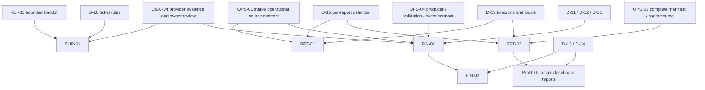

# DISC-04: Dev 3 discovery and readiness

Baseline: c40650299674faca3f4d5e6cb92a8675ac6c1ffc, verified remote main 2026-11-14. Branch: docs/disc-04-dev3-readiness. Documentation only; no implementation, migration, seed, shared-contract edit, merge, deployment or live provider access. Repository/offline discovery deliverable complete for available evidence; formal DISC-04 provider-observation/owner-acceptance criteria remain BLOCKED. Independent QA completed; sole P2 corrected and bounded recheck confirmed resolved.

## Evidence and method

Current evidence vocabulary: LEGACY_VERIFIED = directly established legacy behavior with exact safe provenance and enough evidence for the stated claim (not automatic business approval); REPO_VERIFIED = inspected repository/configuration fact; INFERRED = interpretation not directly established; UNVERIFIED = absent/incomplete direct evidence. Historical PROVIDER_OBSERVED menu notes remain inherited label evidence and are not promoted to LEGACY_VERIFIED. TBD describes decision status; BLOCKED describes a work/control gate, not evidence that legacy behavior does not exist.

Read AGENTS.md, docs/PRD.md, docs/ROADMAP.md, docs/decisions/DEV2-DEV3-HANDOFF.md, OPS-04-contract.md and four docs/agent-policies policies. Read initial STATE/HANDOFF templates and reconciled actual Git. Superpowers using-superpowers selected workflow, dispatching-parallel-agents separated independent requirements/source/offline exploration, writing-plans structured the discovery/dependency plan in this allowed document, systematic-debugging traced stale claims to source/API evidence without fixes. requesting-code-review and verification-before-completion support final review/checks. No implementation/TDD workflow invoked. Plan location follows user's six-file write restriction; no redundant implementation plan created.

Discovery plan: verify baseline/policies -> save initial checkpoint -> independent inventories -> local comparison -> dependency/decision synthesis -> independent QA -> file/scope verification and local documentation commit. Lead owns all six documents; specialists write none. Requirements/source role presets GPT-6.1 Sol Medium; safety/reviewer presets fixed Sol High. Parent runtime/model cannot be changed by the agent; no claim that a model switch occurred.

## Baseline, PR #9 and stale snapshots

- REPO_VERIFIED: local main HEAD, GitHub main API and git ls-remote origin refs/heads/main agreed at c40650299674faca3f4d5e6cb92a8675ac6c1ffc. Remote code-craft-id/logistik-web. PR #9 merged at 2026-11-13T12:36:55Z, squash/merge SHA same baseline; final head 561a382746e96eab46e47d9dc4dc1b3be7863688. Sources: https://github.com/code-craft-id/logistik-web/pull/9 and GitHub REST pulls/9, branches/main.
- REPO_VERIFIED: reviews endpoint records APPROVED on final PR head at 2026-11-13T11:52:00Z. Earlier changes-requested/commented/dismissed reviews are history. docs/decisions/DEV2-DEV3-HANDOFF.md:7 OPEN/CHANGES_REQUESTED is stale. Approval accepts PR scope; it does not confirm D-11..D-16/D-19/D-21 or prove missing staging artifacts.
- Worktree dirty before this run: .gitignore, AGENTS.md; untracked docs/agent-policies/, docs/agent-prompts/, docs/agent-state/. No existing work reset/staged by this run outside six checkpoint files. Created requested docs branch at identical baseline; no source version changed, no server restart.
- PR body reports 44 files/423 tests and 11 integration files/98 tests at earlier PR commits; these are AUTHOR-REPORTED, not fresh baseline verification. docs/decisions/evidence/pr-9-staging-smoke.md:5-20 still contains user-reported PASS with missing tester/time/environment/deployed SHA/per-scenario artifacts. Merge/approval and incomplete staged-evidence documentation can both be true.
- OPS-04-contract.md:13 names nonexistent src/features/bookings/billing-events.ts. Actual declaration src/features/bookings/billing-contract.ts:1. Proposal status is correctly PROPOSED, not emitted/enforced.
- Historical FND-03 inventory (FND-03-iteration-2.md:115) and SCH-01 historical Customer absence (SCH-01.md:135) are not current model evidence. Current sales schema has operations/Customer/Consignee references. Dashboard preview description also predates operational booking/transaction routes; all quick actions still describe UI previews (dashboard-overview.tsx:26,133-136).
- ROADMAP.md:111 archival advice conflicts with specific confirmed D-29 non-archival rule (PRD.md:175,243). Follow D-29; no private images/records copied.

## Runtime versus previews and source contracts

| Finding | Category / evidence | Readiness consequence |
| --- | --- | --- |
| Booking create, transaction create/lookup/detail/status services/actions exist; operational UI routes present | REPO_VERIFIED; src/features/bookings/{actions.ts,lookup-actions.ts,server/service.ts,server/queries.ts}, src/app/(dashboard)/{bookings,transactions}/; handoff:17-19,43-50 | Existence does not approve D-05..D-07/D-21, staging or report semantics. Local browser flow not verified. |
| Manifest mutations exist but /manifest is preview | REPO_VERIFIED; src/features/shipments/manifests-actions.ts; server/manifests-service.ts; src/app/(dashboard)/manifest/page.tsx:1 | OPS-03 remains partial, not end-to-end delivery. |
| Outcome requires an existing sheet; generator absent in source search | REPO_VERIFIED; manifests-service.ts:257-260; item creation at :320 is not sheet generation; sales.prisma:256 unique manifestId | Dev 2 generation/eligibility/numbering/retry contract needed. Do not assume delivery report source population complete. |
| Assignment globally unique per transaction; released reassignment denied | REPO_VERIFIED; prisma/schema/sales.prisma:248; authorization-booking-transaction-manifest-delivery.test.ts:570 | D-08 remains TBD; do not design re-manifest reports around invented multiple assignment behavior. |
| OPS-04 type unused by runtime producer/validator/consumer in inspected src/tests | REPO_VERIFIED; billing-contract.ts:1; OPS-04-contract.md:3,9-14,46-65 | FIN-01 blocked by missing event lifecycle, transport normalization, dedupe and vendor/service mapping, as well as D-11. |
| All report routes use synthetic PreviewScreenPage metadata; export disabled | REPO_VERIFIED; branch-reports/transaction-details/page.tsx:1; reports/preview/screens.ts:3; components/patterns/preview-screen.tsx:20; preview-workspace.tsx:286,332,603,682 | No operational report query, approved financial total or functioning export established. See REPORT_CATALOGUE.md. |
| /ticketting preview only; no Ticket Prisma model/service/query/action found | REPO_VERIFIED; ticketting/page.tsx:1; features/ticketing/preview/screens.ts:5-162 | SUP-01 blocked D-16. Exact route spelling ticketting differs from feature ticketing and target structure; do not rename without contract review. |
| Dashboard authenticates but metrics unavailable, charts synthetic and filters local | REPO_VERIFIED; dashboard/page.tsx:10; dashboard-overview.tsx:88-109; dashboard-filters.tsx:12,83; dashboard-chart.tsx:31 | No KPI pipeline/approved metrics; labels are not definitions. |
| Financial drafts unused by inspected runtime; guard is policy/current nonuse | REPO_VERIFIED; prisma/schema/accounting.prisma DRAFT comments; db/index.ts:10 ordinary client; sch01-schema.test.ts:83 regex-checks comments | No technical draft-denial guarantee. AccountingBranch differs from organization Branch (:52). No operational Invoice/Payment model found. No finance readiness. |

Naming: provider Manifest Vendor vs preview Penjual Manifes, financial/customer/courier workspace names and report recaps cannot be assumed semantic equivalents. Catalogue lists unmapped standalone Rekap Transaksi, Rekap Manifest, Rekap Transaksi Harian. Existing branch-reports/daily-turnover-summary is not proof it satisfies either transaction recap.

## Authorization and tests

REPO_VERIFIED: identity/permissions.ts:2 registers operational booking/transaction/manifest/delivery grants, no report/dashboard/ticket/accounting workflow grants. Active actor/group and system_admin:manage define admin authority, not a role label. New unknown resource/action denies even admin until inventory reviewed. lib/auth/session.ts:34 says empty branches do not mean HQ/global.

bookings/server/queries.ts:23,47,87,114 filters deleted rows and scopes branch records; transaction scope is origin OR destination at :104. Internal query helpers rely on page/action callers for action permission checks (transactions/page.tsx:10, [id]/page.tsx:20); this is an existing call-site contract, not report authorization. Future reports need independently authenticated/authorized entry points, reviewed grants and validated branch/date/status/pagination/export contracts. Default take=50 is not an approved or fully validated report paging API. accessible-navigation.ts:19 inventory lacks several operational and Dev3 route mappings; menu visibility is not route readiness/authorization. The workspace layout alone does not authorize arbitrary children; proxy.ts supplies session boundary, which is distinct from per-entry data authorization.

Coverage inspected, NOT executed:

- tests/features/bookings/idempotency.test.ts:161 replay, :219 conflict, :268/:293 manufactured P2002 recovery; Prisma mocked, not overlapping PostgreSQL transactions.
- tests/unit/authorization-booking-transaction-manifest-delivery.test.ts:66 mocked DB covers service denial/scope/soft-delete cases; not real concurrency proof.
- tests/unit/manifests-security.test.ts:41,45 membership/unique-constraint titles only assert branch membership; cannot establish sheet membership or DB uniqueness enforcement.
- tests/integration/sch01.test.ts:130 uniqueness covers customer tax profiles, not operational idempotency/races.
- tests/unit/dashboard-ssr.test.ts:7 and preview UI tests concern synthetic presentation, not metric reconciliation.

Dev 2-owned follow-up: guarded logistik_web_test concurrency regression for simultaneous same-key creates, manifest assignment, outcome/status atomicity. This is a proposed cross-domain task, not authorized implementation or an unmerged blocker retroactively imposed on PR #9. No test DB accessed.

## Local server verification and limitations

REPO_VERIFIED listener on port 3000, PID 9828, command points to this checkout's next start-server.js. Existing server reused and preserved. HTTP/UI UNVERIFIED: local-only isolated Chrome new_page report request timed out at 10s; curl HEAD localhost/login timed out at 20s; direct no-proxy 127.0.0.1/login timed out at 15s, zero bytes, curl 28 both. Subsequent shell commands succeeded, so batch exit 0 must not be called HTTP success. No authenticated UI/responsive/manual staging check completed.

Listener executable Node v26.13.0 differs from package.json engines >=24.15.0 <25. Cause of timeout UNVERIFIED; no repair/restart authorized by documentation-only scope. Chrome page metadata listed an existing legacy tab after failed local-tab creation; no DOM/snapshot/auth/network inspection or navigation performed against it. Metadata presence establishes neither legacy authentication nor a safety boundary.

## Provider and decision evidence

Inherited PROVIDER_OBSERVED report-menu notes contain 22 leaves; source/provenance and 19 primary plus four rendered AR/AP supplemental synthetic views are in REPORT_CATALOGUE.md. Original per-entry timestamps, observer/role, routes, sample outputs and approval are missing. No fresh provider observation; report images remain uninspected/UNVERIFIED. Accounting/ticket descendants lack verified provider evidence. Ticket preview labels Pending/Revisi/Selesai and Approve Finish do not establish transitions, assignment or approval authority. Linked AWB/customer access and comment/upload privacy remain questions.

LEGACY-ACCESS-GATE.md is NOT_VERIFIED / DENY: owner/reviewer/evidence unset, routes NONE, enforcement not established. Authentication UNVERIFIED; no login requested, performed or credentials handled. Continue offline. Human/security owner must supply independent comprehensive enforcement/replica evidence, route allowlist (including dangerous GETs), bypass/background/service worker/WebSocket/redirect coverage, nonproduction protection verification and explicit observation authorization. Do not test by mutating production. Only after verified gate + explicit authorization may manual login handoff be used; user alone enters credentials. Login can write session metadata.

All requested decisions D-11..D-16,D-19,D-21 remain authoritative TBD (PRD.md:157-167). DECISIONS.md now separates observation-answerable behavior, evidence sufficiency, genuine ambiguity and formal adoption approval; earlier speculative alternatives are superseded by migration-first parity. No approval inferred from merge, menu labels, Decimal fields, schema port or Dev 1 bounded acceptance.

## Dependency graph and readiness

All new workflow permission inventories/shared schema/API changes require Dev 1/domain peer review before implementation. D-05..D-09 apply to source-dependent assumptions; D-25 applies to personal data/comments/exports. RPT-02 row omits D-19 explicitly but date-based reports still need it; GP metrics require D-14 despite broad RPT-02 naming.

| Ticket | Readiness | Exact remaining gates |
| --- | --- | --- |
| SUP-01 | BLOCKED | D-16 visibility/assignment/lifecycle; permitted linked-record access; grant/schema contract review; provider evidence and DISC-04 acceptance |
| RPT-01 | BLOCKED | D-15 transaction-detail definition/sample; D-19 cutoffs/formatting; stable source and approved branch attribution; report/export grants; provider parity |
| RPT-02 | BLOCKED | Per-report D-15/D-19; OPS-03 partial and sheet generation gap; D-08/D-09 semantics; vendor linkage, KPI source contracts; D-14 for finance metrics |
| FIN-01 | BLOCKED | D-11/D-12/D-21; OPS-04 proposal lacks runtime contract; stable OPS-01 references; invoice/payment design review; DISC-04 finance evidence |
| FIN-02 | BLOCKED | FIN-01, D-13/D-14 chart/posting/recognition/costs and reconciliations; draft models cannot substitute |

Top two implementation candidates: **NONE proven READY**. Do not relabel conditional priorities as executable tickets. Conditional order after approvals: (1) RPT-01 transaction-detail with non-financial fields only if separately approved, (2) SUP-01 ticket create/list/detail/lifecycle with its approved matrix; select exactly one, not both. RPT-02 follows complete source contracts; FIN remains later gated work. Each eventual slice owns UI/service/validation/auth/tests end-to-end, not FE/BE split.

Next action under the migration-first clarification: establish independently verified observation protection and scoped authorization, then collect the missing direct legacy behavior evidence. Use the existing source/catalogue inventory; do not repeat repository discovery or ask business to redesign known workflows. Reassess evidence coverage and formal approval independently after observation. No live browser access or runtime build may be inferred from this plan.

## Review and verification record

Independent qa_reviewer reviewed all six documents and owning source/policies. Sole P2: four AR/AP supplemental views/footer omitted; lead added them and reviewer confirmed resolved. No other actionable findings. Final document/scope command results and commit metadata are recorded in RUN_LOG.md. No lint/typecheck/unit/integration/build/migration/staging success claimed for this run. A build could conflict with existing server artifacts and is unnecessary for documentation-only changes. RUN_LOG.md records actual checks, exact SHA and limitations; STATE.md/HANDOFF.md remain authoritative resume pointers.

## Legacy Parity Specification: observation access and proposed acceptance

Continuation 2026-11-14, baseline HEAD 0cf4554937d63b954ee85d61833c9acbd085c2db. This section is an evidence-collection/acceptance specification with explicit gaps, not a completed provider behavior specification. **No LEGACY_VERIFIED business behavior was added in this continuation.** The outstanding live provider discovery remains BLOCKED; prior offline inventory does not complete it.

### What is established now

- REPO_VERIFIED: active mcp__chrome_devtools_lab metadata exposes inspection capabilities. A single metadata-only list_pages call succeeded and listed the reference legacy origin. It did not inspect content or authenticate. Dedicated Chrome profile/browser identity, backend endpoint and external enforcement are UNVERIFIED; URL match alone does not verify the intended protected session.
- REPO_VERIFIED: narrowly parsed primary Codex configuration has a separate disabled chrome-devtools stdio entry (npx, chrome-devtools-mcp@latest, no CLI switches). This is not proof that the active lab tools use that entry or that any read-only mode is active. No configuration changed; no secret/URL/env values copied.
- REPO_VERIFIED policy state: docs/agent-policies/LEGACY-ACCESS-GATE.md remains human-controlled NOT_VERIFIED, routes NONE, independent reviewer/enforcement/authorization evidence absent. The mission authorizes assessment and conditional observation, not self-approval of a missing gate.

| Capability or safeguard | Technically enforceable scope / limitation | Present status |
| --- | --- | --- |
| Reviewed read-only replica, preferably synthetic and isolated from production/integrations | Can prevent production effects if isolation, data privacy and every write/side-effect surface are independently verified | NOT PROVIDED / UNVERIFIED; preferred route |
| Verified server-side read-only account | Can enforce denied business mutations when all endpoints/background jobs/external effects are covered; an account name is no proof | NOT PROVIDED / UNVERIFIED |
| Mandatory external enforcement | Could qualify only with all-path bypass denial, dangerous GET coverage, redirects/background/service workers/WebSockets and nonproduction test evidence | No qualifying mechanism established |
| Route allowlist and task authorization | Human documentation defines scope; technical only if actually enforced | NONE approved; independent gate evidence and scoped authorization missing |
| DOM snapshot/CSS/current-page inspection | Reads browser-held/rendered information; does not intentionally navigate, but cannot prevent existing background traffic or PII exposure | Available tools; no current-page exception; blocked before gate |
| Screenshot, console/network payload, heap, trace, screencast/Lighthouse | Broad capture can expose PII/auth artifacts; some diagnostics reload or exercise pages | Not needed for initial observation; do not inspect raw headers/cookies/tokens or archive provider images |
| navigate/new_page/reload/wait/select | Navigation may invoke dangerous GETs; waiting/selection does not stop app activity | Not a protection mechanism; prohibited against live legacy before gate |
| Offline emulation / extra headers | Browser-local settings are not independent all-path enforcement; headers alter traffic, offline changes may leave other targets/connections or queued work | Not applied; do not test on live Administrator session or reconnect queued effects |
| No evaluation tool exposed, or evaluation disabled | Removes one automation path; does not disable page scripts, native navigation or background behavior | Not comprehensive mutation protection; page-JS state unverified |
| Read-only sandbox, instruction to avoid clicks, modern role/security rules | Procedural discipline and target-system requirements | Necessary but insufficient to qualify live access |

Already loaded Administrator pages and automated navigation are different exposure paths. A DOM read may avoid an intentional new navigation, but the account remains privileged and its application may continue timers, network activity, service workers or WebSockets. Snapshotting can reveal private data even without a click. LEGACY-READONLY.md explicitly places DOM observation after clearance. No DOM/screenshot/network payload was inspected, no page isolation/offline experiment performed, and no legacy session was refreshed or changed.

### Narrowest qualifying workflow (proposed, not activated)

1. Human owner/security reviewer provides a protected read-only replica, preferably prepopulated synthetic cases, or verifies equivalent complete server-side read-only enforcement. Isolation includes business DB writes, side-effect services/queues/integrations and background paths. Prove protection in a nonproduction test environment, never by probing live mutation endpoints. An ordinary Administrator account plus a method filter does not qualify.
2. The independent human records environment identity, Chrome session/profile, permitted origin/routes/interactions, full-path protection and bypass-denial evidence, nonproduction verification, privacy restrictions and reviewer/date in the human-controlled gate. Agents do not edit it to VERIFIED.
3. Obtain explicit authorization for that exact environment and observation scope. Reviewed technical safety and human task authorization are separate; this conditional mission alone is not evidence of either protection or final scoped consent.
4. Only then connect to the approved dedicated session. If login is required, ask the user to sign in manually at the approved environment URL without sharing credentials. Do not request a legacy login now. Agent never types or reads credentials, exports cookies, or inspects password/auth payloads. User confirmation permits only approved read-only session verification; login may write authentication metadata and must be covered by the approved setup.
5. Delegate only the approved observation scope to legacy_observer. Start with minimal label/structure inspection of permitted already-loaded non-sensitive views. First reports, then ticketing, accounting, dashboard; navigate/filter only routes/interactions individually reviewed as safe and within the verified enforcement. No create/update/status/approve/import/export action, no mutation-based lifecycle testing. Inspect existing sanitized histories/rules and owner-prepared synthetic cases instead.
6. Record exact permitted route, UTC date/time, role/scope, reviewer/gate reference, synthetic case reference, precise input and observed output, uncertainty and D-ID. Store sanitized text only, no raw private payloads/screenshots/records. Stop on any unexpected risk; no automatic repair/revert/retry.
7. Reevaluate evidence sufficiency for proposed acceptance, then obtain required formal adoption approvals under the unchanged PRD. Escalate only gaps, contradiction, unsafe behavior or new deviations. Modern security, branch checks, audit and financial invariants remain; do not replicate vulnerabilities.

Minimum human action now: arrange the reviewed replica or verified read-only enforcement and have the independent owner/security reviewer provide the above non-sensitive evidence plus exact scope/authorization. Credentials, a signed-in Administrator tab, a CDP connection or a statement to avoid clicks cannot replace it. If unavailable, an owner-approved sanitized textual evidence packet can support offline discovery only; it must not be reported as live observation completion.

### Testable parity specification and evidence gaps

Each future parity requirement uses an ID, LEGACY_VERIFIED evidence reference(s), exact permitted source route and role, legacy input/defaults, observed output, new-system source mapping, testable equality/authorized security deviation, and separate formal approval reference. Original report labels/preview data are not a sufficient oracle. Proposed test cases below are **NOT EXECUTED**, have no invented expected values, and do not authorize feature implementation or live mutation.

| Parity case | Required safe observation / oracle | Proposed regression acceptance once evidence is sufficient | Current behavior evidence / approval |
| --- | --- | --- | --- |
| LP-REPORT-STRUCTURE (each catalogue report) | Observed columns/order/filter defaults, search/sort/page controls, unit/format labels from safe reviewed views | New view reproduces verified labels/order/defaults and safe interactions for same permitted inputs | UNVERIFIED beyond inherited labels; approval pending separately |
| LP-REPORT-ROWS | Owner-prepared synthetic cases plus observed date/status/branch filters; provenance ties each included/excluded row to a source key without real identifiers | Same source population and inputs yield identical row set/count/order under approved modern branch scope | UNVERIFIED; approval pending |
| LP-DATE-BOUNDARY | Known instants around day/month/year boundaries, explicit timezone/configuration and displayed/filter results | Inclusion/cutoffs/format/export timestamps match the verified legacy rule, not browser locale guess | UNVERIFIED, D-19 approval pending |
| LP-TOTALS / LP-FINANCE | Read-only authoritative calculation evidence and sufficient synthetic examples for rate/tax/discount/cost/rounding/recognition | Decimal totals/components reconcile to the same sources, precision and rule; reverse/correction behavior respects approved invariant | UNVERIFIED; candidate reverse-engineered formulas INFERRED until corroborated; D-11..D-15 approval pending |
| LP-TICKET-LIFECYCLE | Sanitized existing transition/assignment/reopen histories plus verified rule/role evidence, not action labels or agent clicks | Permitted transitions, chronology and linked access match verified behavior; unauthorized modern paths deny without writes | UNVERIFIED; D-16/D-21 approval pending |
| LP-APPROVALS / LP-AUTH | Read-only approved role/policy and existing approval histories, including representative non-admin branch contexts | Verified required approval sequence preserved; modern server grants/scope independently enforce allowed/denied cases | UNVERIFIED; Administrator visibility insufficient; D-21 approval pending |
| LP-DASHBOARD | Each KPI definition/filter and source-to-output reconciliation for known synthetic cases | KPI rows/counts/amounts and date scope match verified report/source definitions; no synthetic repository placeholders as oracle | UNVERIFIED; applicable D-15/D-19/finance approvals pending |
| LP-EXPORT | Only separately authorized non-mutating, non-sensitive export evidence or permitted sanitized artifact | Header/order/format/filters/totals/scope match verified export; no PII leakage; protected bounded authorization | UNVERIFIED; button existence is not functioning export evidence or permission |

The existing REPORT_CATALOGUE source mappings remain candidate technical mappings, not proof of equivalence. No feature is now proven behavior-complete or READY. Crucially, pending formal approval is not described as absent legacy behavior: the direct evidence is currently missing because safe access has not been established. A future directly verified rule may be fully evidenced yet still await formal adoption; that is APPROVAL_PENDING, not BEHAVIOR_UNVERIFIED.

Continuation QA: independent qa_reviewer found no actionable corrections in the safety/control assessment, parity evidence/approval split, 22 report IDs/four supplemental view mapping or planned test cases. No browser/network/DB/tests were performed. Document validation and current commit/hand-off metadata are recorded in RUN_LOG.md. Live provider discovery remains incomplete.
